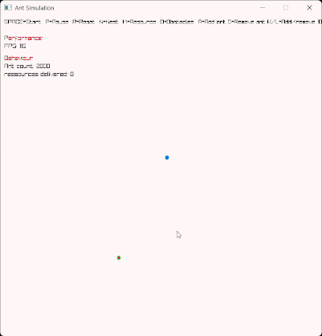

# Ant Colony Simulation

A real-time ant colony simulation in C++17 with [raylib](https://www.raylib.com/). Ants find a short path between their nest and a food source through *stigmergy*: they communicate only by laying and following pheromone trails, as in Ant Colony Optimization (Dorigo).

The ant system is implemented twice, once as **object-oriented** code and once as **data-oriented** code, to compare how the two designs perform as the number of ants grows.



## How it works

The world is an 80×80 grid. Each cell is either walkable or an obstacle, and holds a pheromone level.

**Searching.** An ant that is looking for food moves one cell per tick (4-neighbourhood). It chooses among its neighbours at random, weighted by:

- **Pheromone strength:** τ^(α/β), so strong trails attract strongly
- **Direction bias:** it prefers to keep going in the direction it is already heading (cosine between its previous step and the candidate step)
- **Noise:** a random factor so it keeps exploring
- **Short-term memory:** it avoids the last 6 cells it visited, so it doesn't oscillate

**Returning.** When an ant reaches the food it walks back along its own recorded path and deposits pheromone on the way. Cells further from the nest receive more pheromone: `0.02 · (1 − e^(−0.08·d))`.

**Environment.**

- Pheromone evaporates by 2.5 % per tick, so trails that aren't reinforced fade away.
- Pheromone saturates softly towards a cap, so no single cell can dominate.
- An ant that hasn't found food after 1000 steps is reset to the nest.

Over time the colony converges on a visible trail between the nest and the food, and it routes around any obstacles you draw.

## Architecture

```
src/
├── main.cpp                      Window, input, rendering. No simulation logic.
└── simulation/
    ├── controller/               Facade between UI and systems; simulation state (stopped/running/paused)
    ├── map_system/               Grid, nest/food positions, pheromone deposit and evaporation
    ├── cell/                     A single grid cell (walkable flag + pheromone)
    ├── ant/ + ant_system/        OOP version: std::vector<Ant>, each ant owns its data and logic
    └── ant_system_dod/           DOD version: Structure of Arrays
```

### OOP vs. DOD

| | OOP (`AntSystem`) | DOD (`AntSystemDOD`) |
|---|---|---|
| Layout | `std::vector<Ant>`, one object per ant | Parallel arrays (`positionX`, `positionY`, `alpha`, `beta`, ...) |
| Neighbour lookup | Returns a `std::vector` per call | Fixed-size stack arrays, no allocation |
| Inner loop | Recomputes per-ant constants for every neighbour | Loop invariants (`α/β`) hoisted out |

The DOD version is the one currently built. To switch to OOP, swap the commented-out `AntSystem` / `AntSystemDOD` lines in `controller.h` and `main.cpp`.

## Next steps

- **Benchmarks:** measure simulation update time per tick (excluding rendering) for OOP vs. DOD at increasing ant counts, using an optimised release build.
- **Runtime switch:** toggle between OOP and DOD from the UI instead of at compile time.
- **Further data-oriented work:** flatten the grid into a single contiguous array and replace the per-ant path vectors with a shared, contiguous buffer.

## Controls

| Key | Action |
|---|---|
| `N` + click | Place nest |
| `M` + click | Place food source |
| `O` + click | Toggle obstacle mode / draw obstacle |
| `A` / `D` | Add / remove 1 ant |
| `K` / `L` | Add / remove 100 ants |
| `Space` | Start (requires nest and food) |
| `P` | Pause |
| `R` | Reset |

## Building (Windows, MSVC)

Requirements: Visual Studio 2022 Build Tools and [raylib for MSVC](https://github.com/raysan5/raylib/releases) (`raylib-*_win64_msvc16`).

From an **x64 Native Tools Command Prompt**:

```bat
cl /std:c++17 /O2 /EHsc /MD ^
   src\main.cpp src\simulation\ant\*.cpp src\simulation\ant_system\*.cpp ^
   src\simulation\ant_system_dod\*.cpp src\simulation\map_system\*.cpp ^
   src\simulation\controller\*.cpp src\simulation\cell\*.cpp ^
   /I C:\raylib-6.2_win64_msvc16\include ^
   /link C:\raylib-6.2_win64_msvc16\lib\raylib.lib ^
   opengl32.lib gdi32.lib winmm.lib user32.lib shell32.lib ^
   /OUT:ant_simulation.exe
```

Adjust the raylib path to match your installation. In VS Code, the default build task (`Ctrl+Shift+B`) runs the same command with debug flags.

## Documentation

The code is documented with Doxygen. Generate the HTML docs with:

```
doxygen Doxyfile
```

Then open `docs/html/index.html`.
